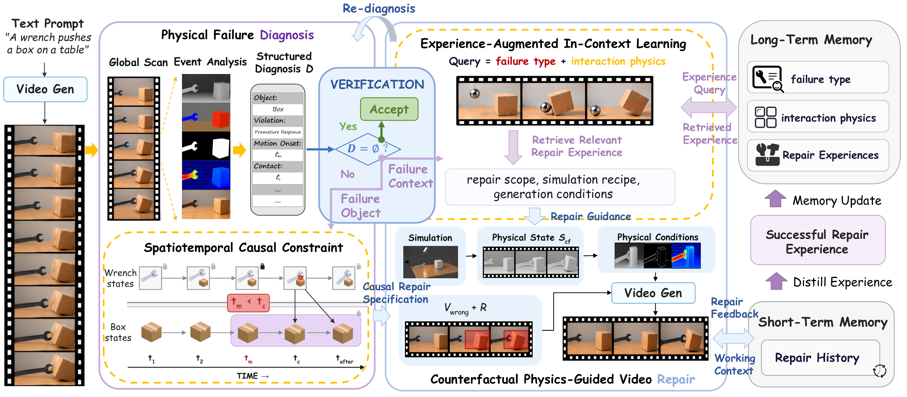
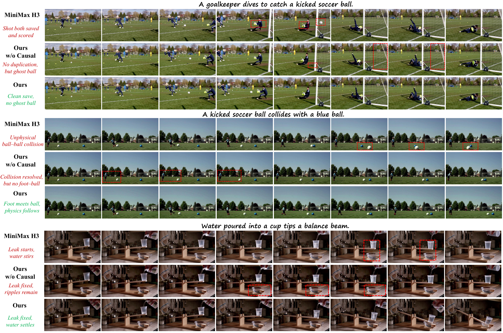

<h1 align="center">PhysRepair: Agentic Physics-Grounded Video Generation<br>via Memory-Augmented In-Context Reasoning</h1>

<p align="center">
  <a href="https://xxkkxxx.github.io/PhysRepair-Website/"></a>
</p>

## Abstract

Physical plausibility is essential for realistic video generation. Existing methods impose physical guidance before synthesis via simulations or refined prompts, but this can limit dynamic diversity, miss errors that emerge only after generation, and require repeated regeneration when inconsistencies remain. We therefore study a *generate–diagnose–repair* paradigm that preserves the original generation capability and selectively repairs physical inconsistencies afterward, raising two key questions: what to repair, and how to repair? To address them, we introduce **PhysRepair**, an agentic video generation framework that combines causal reasoning over the observed physical failure with prior repair experience to enable localized and adaptive correction. Specifically, **Spatiotemporal Causal Constraints** identify the first invalid physical state and its causally affected states, producing a repair specification that guides physically plausible local regeneration while preserving unaffected content. **Experience-augmented In-context Learning** combines the ongoing repair context with relevant experience from previous repairs, allowing the agent to adapt its repair decisions across diverse physical failures and accumulate completed trajectories for future cases. Experiments on Physics-IQ Verified across solid mechanics, fluid dynamics, optics, thermodynamics, and magnetism demonstrate that PhysRepair consistently improves the physical plausibility of generated videos over existing methods.

## Contributions

- **Generate–diagnose–repair:** PhysRepair identifies and corrects physical failures after video generation, enabling targeted intervention while preserving valid dynamics and visual content.
- **Spatiotemporal Causal Constraints:** An object-centric causal representation identifies the first invalid state and its downstream effects, defining what may change and what must remain fixed.
- **Experience-augmented In-context Learning:** Short-term repair context and relevant long-term experience guide adaptive repair decisions; completed trajectories are distilled for future repairs.

## Overview



Starting from a generated video, a Physics Repair Agent diagnoses the observed physical failure and constructs a causal repair specification. Retrieved repair experience guides simulation and localized counterfactual regeneration, followed by physics-and-preservation verification and experience distillation.

## Results

### Causal repair



Event frames compare MiniMax H3, repair without causal constraints, and full PhysRepair on goalkeeper-save, ball-collision, and water-balance interactions.

### Quantitative comparison

Results reported in the manuscript on Physics-IQ Verified. Higher is better for all metrics. **Bold** indicates the best score in each column.

| Method | SP ↑ | ST ↑ | WS ↑ | MSE score ↑ | Physics-IQ ↑ |
| :--- | ---: | ---: | ---: | ---: | ---: |
| MAGI-1 4.5B | 14.3 | 13.3 | 7.0 | — | 18.8 |
| Cosmos-Predict2-2B | — | — | — | — | 27.7 |
| Wan2.2-TI2V-5B | 35.9 | 26.4 | 23.0 | 25.5 | 27.7 |
| CogVideoX-I2V-5B | 37.8 | 35.5 | 21.8 | 32.0 | 31.8 |
| Wan2.2-I2V-14B | 51.1 | 20.5 | 28.5 | 28.9 | 32.2 |
| HunyuanVideo-1.5-I2V | 47.1 | 26.9 | 29.7 | 30.0 | 33.4 |
| MiniMax H3 FL2VA | **58.9** | 22.8 | 40.5 | 37.0 | 39.8 |
| Cosmos3-Super-Image2Video | 57.4 | 32.5 | 43.0 | **37.8** | 42.7 |
| VLIPP | 45.5 | 29.9 | 29.0 | 25.1 | 32.4 |
| PhyCo | 46.2 | **43.8** | 30.5 | 26.8 | 36.8 |
| **PhysRepair (Ours)** | 58.2 | 34.7 | **44.2** | 37.4 | **43.6** |

SP: Spatial IoU; ST: Spatiotemporal IoU; WS: Weighted Spatial IoU. “—” denotes an unreported value.

## Citation

```bibtex
@misc{guan2026physrepair,
  title = {Agentic Physics-Grounded Video Generation via Memory-Augmented In-Context Reasoning},
  year = {2026},
  note = {Manuscript},
  url = {https://xxkkxxx.github.io/PhysRepair-Website/}
}
```
